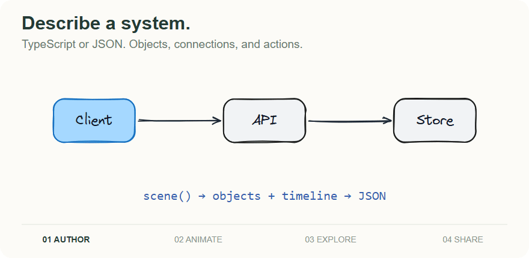
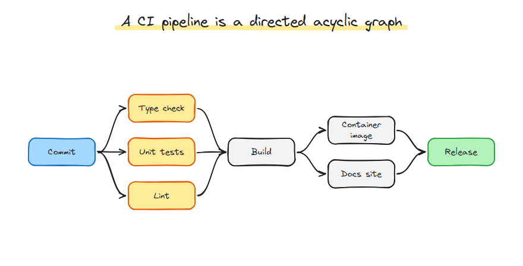
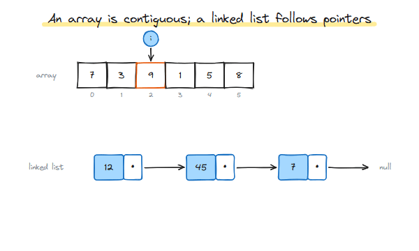
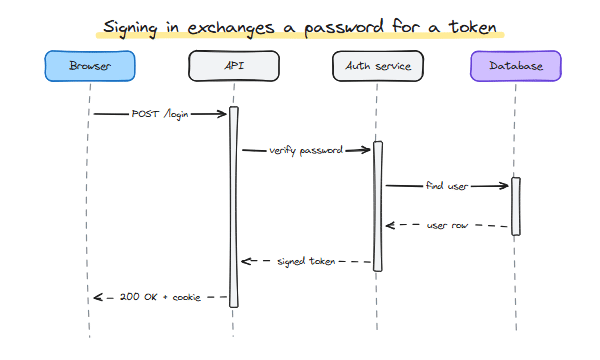
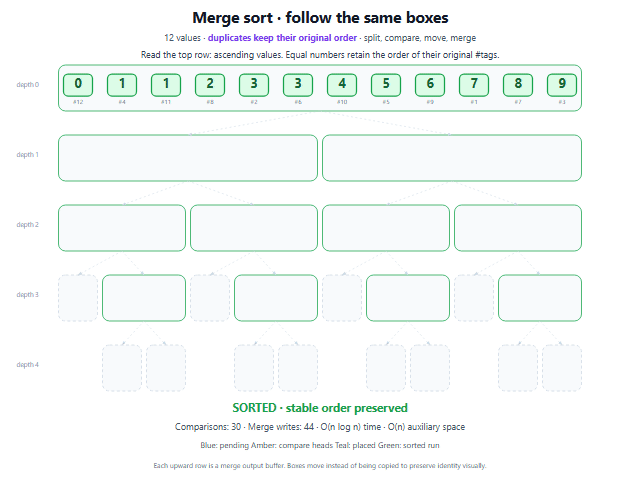
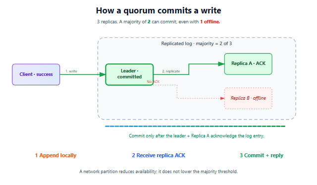
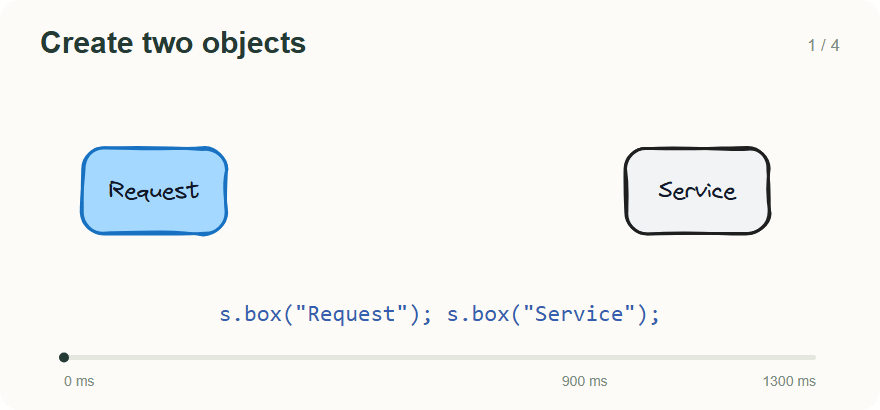

<h1 align="center">Anim8</h1>

<p align="center">Animated diagrams, authored as data.</p>
<p align="center">Explain systems and algorithms with diagrams you can play, scrub, and export.</p>

<p align="center">
  <a href="#why-anim8">Why Anim8?</a> &nbsp;·&nbsp;
  <a href="#examples">Examples</a> &nbsp;·&nbsp;
  <a href="#quickstart">Quickstart</a> &nbsp;·&nbsp;
  <a href="#author-a-scene">Create a scene</a> &nbsp;·&nbsp;
  <a href="#documentation">Docs</a>
</p>



<p align="center">Describe it. Animate it. Explore it. Share it.</p>

---

<a id="what-makes-anim8-useful"></a>

## Why Anim8?

**The goal: make explanations people can explore.** Turn a system, algorithm, or process into a reusable scene, with its relationships and motion kept together.

| Built around | What that gives you |
| --- | --- |
| **Diagrams with a timeline** | Move data through a system, reveal a process in steps, and keep connectors attached as objects move. |
| **Portable scene data** | Author in TypeScript or JSON; inspect, validate, save, and reuse the resulting document. |
| **Any frame, directly** | Play, seek, or reverse the same scene. Use its evaluator for browser playback and exported frames. |

Anim8 combines diagram structure, explicit motion, and an embeddable SVG player. [How it compares with other tools →](docs/guides/choosing-anim8.md)

[Capabilities](#capabilities) · [Integrations](#use-the-library) · [Fonts](#use-your-own-font) · [Exports](#export-an-explanation) · [Comparison](#how-it-compares)

<a id="see-it-move"></a>

## Examples

### CI pipeline



[Scene JSON](examples/diagram-gallery/dag/scene.json) · [Authoring source](examples/diagram-gallery/build.mjs)

| Data structures | Sequence diagrams |
| --- | --- |
|  |  |
| [View scene →](examples/diagram-gallery/data-structures/scene.json) | [View scene →](examples/diagram-gallery/sequence/scene.json) |

| Stable merge sort | Rich styling |
| --- | --- |
|  |  |
| [Example and checks →](examples/merge-sort-motion/README.md) | [Styling example →](examples/complex-styling/README.md) |

[17 diagram families](examples/diagram-gallery/README.md) · [150 teaching scenes](examples/catalog/README.md)

The gallery covers systems, relationships, charts, geometry, and data structures. The teaching catalog spans computing, math/science, and everyday workflows. Every preview links to its editable source.

<details>
<summary><strong>Browse the catalog and offline gallery locally</strong></summary>

For the teaching catalog, run `pnpm catalog:serve` and open **http://127.0.0.1:4178**.

For the interactive diagram gallery:

```sh
pnpm exec playwright install chromium
pnpm gallery:browser
```

Open `artifacts/gallery/index.html` directly. It works offline, with replay and keyboard timeline controls.

</details>

<a id="get-started"></a>

## Quickstart

**Node.js 24 · pnpm 10.28.0**

```sh
git clone https://github.com/nkcbuilds/anim8.git
cd anim8
pnpm install --frozen-lockfile
pnpm build
pnpm playground
```

Open **http://127.0.0.1:4179**. Play a scene, edit its JSON, or export a frame.

*Pre-1.0: use the workspace setup above. The [public npm release](docs/release/README.md) is still pending; APIs may change before 1.0.*

## Author a scene

Create two objects. Connect them. Add motion.



*Rendered from the example below. Build steps are separated; playback is shown at ¼ speed.*

<details>
<summary><strong>Show the TypeScript</strong></summary>

Add `<div id="diagram"></div>` to your page in a workspace consumer:

<!-- quickstart:start -->
```ts
import { scene } from "@anim8/authoring";
import { DIAGRAM_TONES } from "@anim8/core";
import { mountPlayer } from "@anim8/player";

// quickstart:builder:start
const s = scene({ width: 800, height: 360, theme: "sketch", seed: 7 });
const input = s.box("Request", {
  id: "request", x: 160, y: 180, ...DIAGRAM_TONES.blue,
});
const service = s.box("Service", {
  id: "service", x: 540, y: 180, ...DIAGRAM_TONES.neutral,
});
s.connect(input, service);

s.step("Send request", () => {
  s.sequence(input.moveTo({ x: 340, y: 180 }, { duration: 900 }));
});
s.step("Complete", () => {
  s.sequence(service.styleTo(DIAGRAM_TONES.green, { duration: 400 }));
});
// quickstart:builder:end

const player = mountPlayer(document.querySelector("#diagram")!, s.toJSON());
player.play();
// player.pause(); player.seek(450); player.reverse(); player.destroy();
```
<!-- quickstart:end -->

</details>

[Authoring API](packages/authoring/README.md) · [Scene JSON](docs/media/quickstart.scene.json) · [React](packages/react/README.md) · [Vue](packages/vue/README.md) · [Web component](packages/web-component/README.md)

### How it works

**TypeScript / JSON → validate → evaluate(time) → SVG**

The same scene drives playback, seeking, reverse, and export. [Explore the architecture →](docs/architecture/summary.md)

## Capabilities

| Area | Included |
| --- | --- |
| **Diagram objects** | Shapes, paths, text, groups, images, and connectors bound to object edges. Routed connectors can avoid obstacles. |
| **Motion & timing** | Moves, style changes, camera motion, compatible path morphing, named steps, and direct evaluation at any timestamp. |
| **Visual design** | Clean and seeded sketch themes, label fitting, role colours, custom fonts, gradients, rich text, and design checks. |
| **Interaction** | Inputs, bindings, object events, and bounded declarative interactions/state machines. |
| **Layout** | Optional Dagre and ELK adapters for directed graphs. |
| **Delivery** | Browser playback, React/Vue/web components, headless SVG, and optional GIF/MP4 export. |

The same object keeps its identity as it moves. Connectors follow evaluated objects, so a changing diagram stays connected. [Visual design guide](docs/guides/visual-style.md) · [Styling reference](docs/guides/visual-styling.md)

## Use the library

Choose the packages your application needs; the evaluator works without a DOM.

| Your application | Start with |
| --- | --- |
| **Plain browser app** | [`mountPlayer`](packages/player/README.md) for play/pause, seek, speed, reverse, and named-step controls. |
| **Framework app** | [React](packages/react/README.md), [Vue](packages/vue/README.md), or the [web component](packages/web-component/README.md). |
| **Node.js / static output** | [Core evaluator](packages/core/README.md), [clean SVG](packages/renderer-svg/README.md), or [sketch SVG](packages/renderer-sketch/README.md). |
| **Imported or generated scenes** | [Compiler](packages/compiler/README.md), [JSON schema](packages/compiler/scene.schema.json), and [scene format](docs/reference/scene-format.md). |
| **Text authoring or agents** | [DSL](packages/dsl/README.md), [agent guide](docs/guides/ai-agents.md), and [authoring skill](SKILL.md). |

<details>
<summary><strong>Validate imported JSON and render an SVG frame</strong></summary>

`source` is a scene JSON string. Compile it before passing the result to a player or renderer:

```ts
import { compileJson } from "@anim8/compiler";
import { evaluate } from "@anim8/core";
import { renderSketchSvg } from "@anim8/renderer-sketch";

const result = compileJson(source);
if (!result.ok || !result.scene) {
  throw new Error(JSON.stringify(result.diagnostics));
}

const svg = renderSketchSvg(evaluate(result.scene, 1250));
```

Compiler diagnostics include codes and field paths, so generated scenes can be inspected and repaired without executing them as JavaScript.

</details>

## Use your own font

Set a scene default, then override individual labels when needed. Both themes support this, including connector labels.

```ts
const s = scene({ fontFamily: '"My Brand Font", sans-serif' });
s.box("Uses the scene font");
s.text("const answer = 42", { fontFamily: "monospace" });
```

Load custom fonts in your app with `@font-face` or your framework's font loader. Custom font files remain host-supplied and are not automatically embedded in exported SVGs. [Font loading & export behaviour →](docs/guides/visual-styling.md#fonts)

## Export an explanation

**SVG:** built packages only. **GIF / MP4:** also install Playwright Chromium and FFmpeg.

```sh
node packages/cli/dist/cli.js validate examples/diagram-gallery/dag/scene.json
node packages/cli/dist/cli.js render examples/diagram-gallery/dag/scene.json 3000 frame.svg
node packages/export/dist/cli.js examples/diagram-gallery/dag/scene.json frames/ --fps 12
node packages/export/dist/cli.js examples/diagram-gallery/dag/scene.json pipeline.mp4 --fps 12
```

Exports are create-only: choose a new destination for each run. [Export options & limits](packages/export/README.md) · [Reproduce the README animations](docs/media/README.md)

<a id="where-anim8-fits"></a>

## How it compares

Anim8 focuses on **portable diagram scenes with explicit motion and an embeddable SVG player**. Other tools also support animation and seeking; the choice is what you want to author and deliver.

| Tool | Its focus | Choose Anim8 for |
| --- | --- | --- |
| Mermaid | Text-defined diagrams | Diagram objects moving through a seekable timeline. |
| Excalidraw | Visual diagram drawing | Authoring and playing a diagram's motion as data. |
| GSAP | General JavaScript animation | Diagram objects, bound connectors, and scene validation. |
| Motion Canvas | Explanatory vector animation | Declarative JSON interchange and a framework-independent player. |
| Manim | Mathematical animation | An interactive web diagram in a JS/TS application. |
| Remotion | React video compositions | An SVG scene evaluated independently of React. |

[Full comparison with source links →](docs/guides/choosing-anim8.md)

## Documentation

| Task | Reference |
| --- | --- |
| Author an explanation | [Authoring API](packages/authoring/README.md) · [Agent guide](docs/guides/ai-agents.md) · [Visual design](docs/guides/visual-style.md) |
| Style and arrange a scene | [Rich styling & fonts](docs/guides/visual-styling.md) · [Layouts](packages/layout/README.md) · [Presets](packages/presets/README.md) |
| Understand the data model | [Scene format](docs/reference/scene-format.md) · [Timeline](docs/reference/timeline.md) · [JSON schema](packages/compiler/scene.schema.json) |
| Embed and export | [Player API](packages/player/README.md) · [Accessibility](docs/guides/accessibility.md) · [Export API](packages/export/README.md) |
| Explore the library | [All packages](packages/) · [Architecture](docs/architecture/summary.md) · [Architecture decisions](docs/architecture/decisions/) |
| Track project status | [Changelog](CHANGELOG.md) · [Release checklist](docs/release/README.md) |

<a id="capabilities-and-boundaries"></a>

## Scope & security

It does not provide a 3D engine, physics, voice-over production, mathematical typesetting, or a full visual scene editor. The playground edits JSON.

Validate imported JSON with the compiler. It enforces structural and resource limits without executing scene JavaScript. Default media export blocks external asset requests. [Security model →](docs/security.md)

Sketch playback can load its bundled font lazily with ESM code splitting; a single-file bundle includes it up front. [Startup and lazy bundle measurements →](benchmarks/check-runtime-size.mjs)

## Development and verification

```sh
pnpm check                 # types, unit tests, builds, packages, consumers, scenes
pnpm docs:check            # README links, executable example, animation checksums
pnpm bundle:check          # startup bundle ceiling and lazy bytes
pnpm exec playwright install chromium firefox webkit
pnpm release:check
```

Browser qualification includes mobile emulation and CPU throttling, rather than physical-device tests. [Model-provider smoke tests](tests/model-eval/README.md) use offline mocks.

The suite checks playback, retained object identity, SSR hydration, rich styles, reveal pixels, and seek parity. Live model quality and teaching accuracy need separate evaluation.

Include a small scene and timestamp when reporting a bug. [Regenerate README animations →](docs/media/README.md)

---

## License

[MIT](LICENSE) · Bundled Virgil font: [SIL OFL 1.1](packages/renderer-sketch/assets/Virgil-LICENSE.md)
